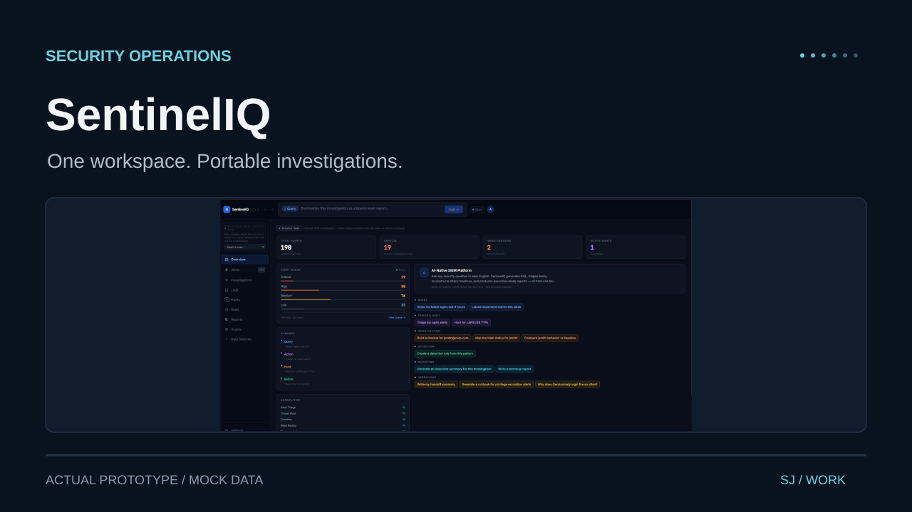
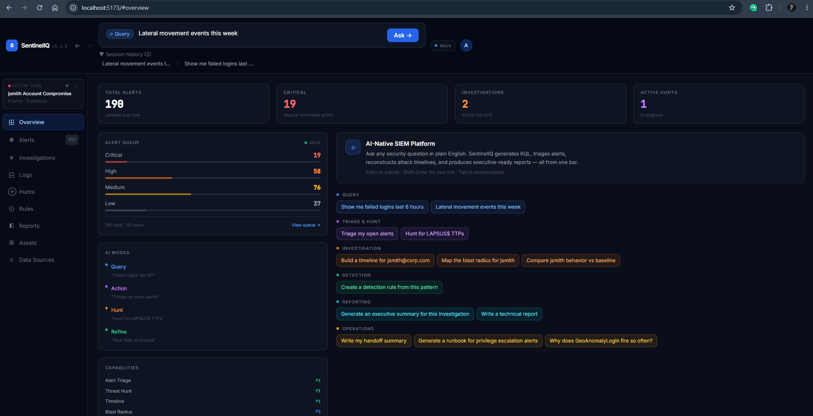
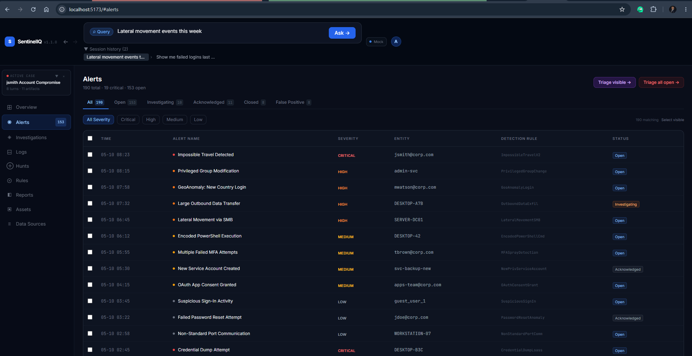
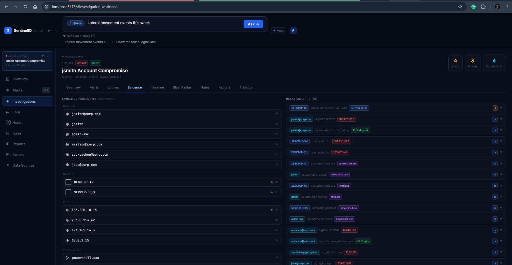
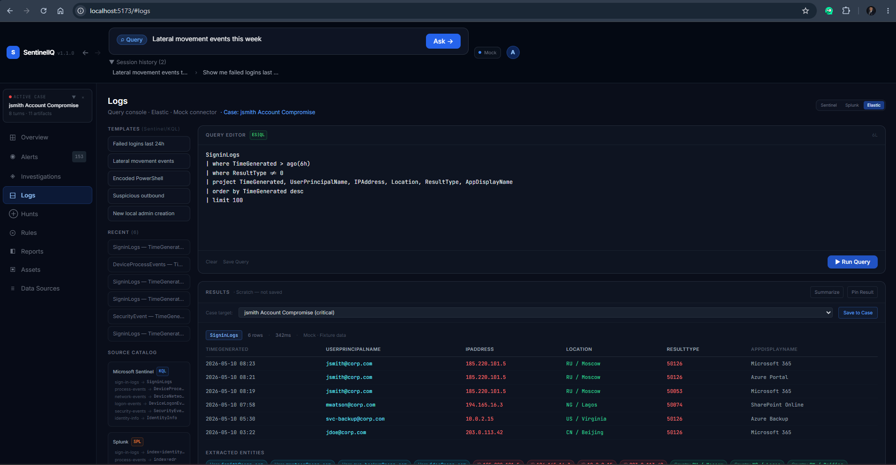
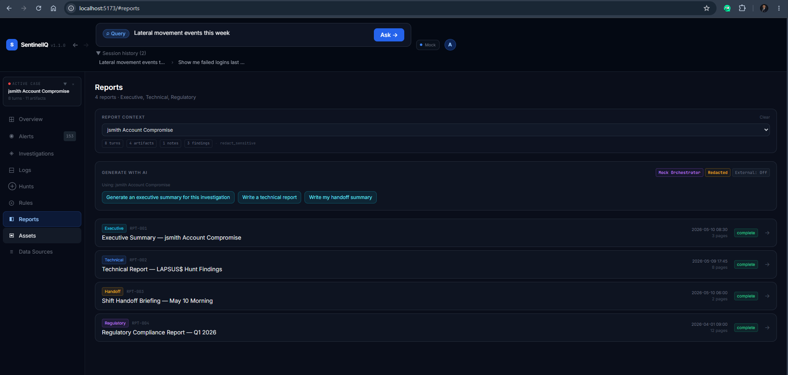
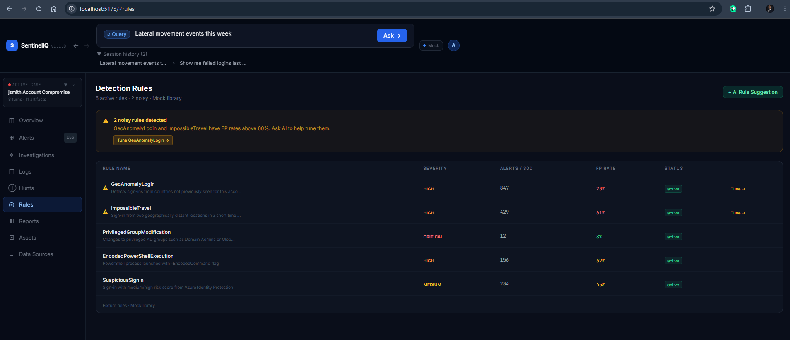
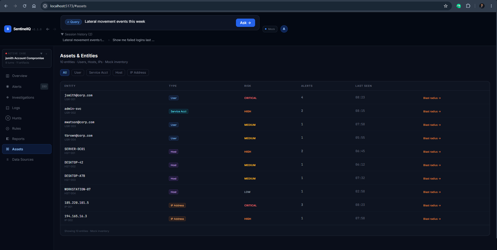

# SentinelIQ demo screenshots

A separate portfolio cover and original screenshots from the June 7, 2026
local demo. These illustrate the prototype with demo data, not a live SOC
connection. Browser chrome is preserved in the captures.

## Overview

## Alerts

## Evidence

## Logs

## Reports

## Detection Rules

## Assets Entities

The source archive also includes a 232 MB demo video. It is not included in
this image collection. The cover is a typographic SVG using the existing
mock-mode overview screenshot.
